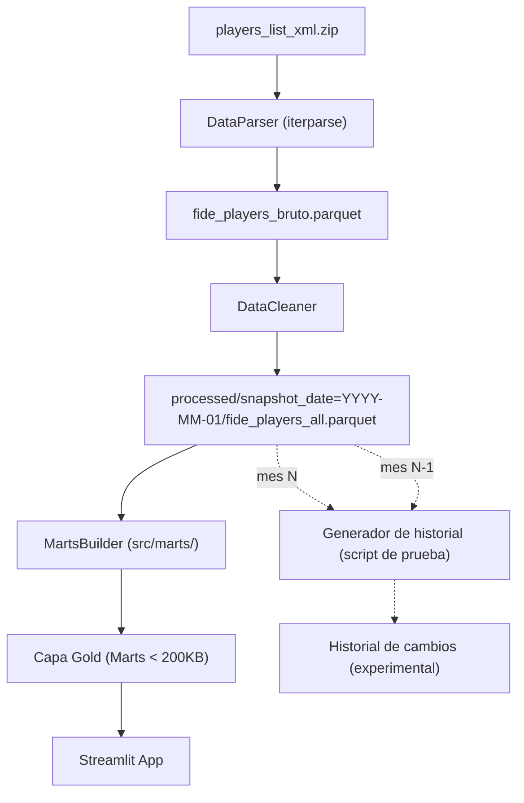

# Visión y Arquitectura Integral ETL / Data Platform

**Proyecto:** Kepler-ChessAnalitic  
**Objetivo Principal:** Migrar de un modelo acoplado (donde la app web procesa datos masivos) a una Arquitectura Medallion por capas, delegando el cómputo pesado al motor ETL en `src/`.

## 1. Reglas Arquitectónicas (Principio Rector)
> "Los Notebooks exploran; el Motor ETL ejecuta y produce; la Aplicación Web visualiza."

* **`notebooks/`:** Entorno estrictamente de lectura/exploración. Prohibida la escritura en entornos productivos (`data/marts/`, `data/processed/`).
* **`src/`:** Motor ETL determinista. Único responsable de limpiar, generar parquets de estudio local, validar logica de negociso e integrar con superbase. La generacion de marts es momentanea.
* **`web/`:** Plataforma para visualizar listado y evolucion de cada jugador durante los meses.
* **`app/`:** Aplicación Streamlit. Solo consume Data Marts (Capa Oro). Prohibido el uso de Pandas para cálculos complejos o Scipy en runtime.

## 2. Arquitectura por Capas (Medallion)
* **Capa 1 (Raw/Bronce) `data/raw/`:** Almacenamiento inmutable del XML comprimido descargado de FIDE.
* **Capa 2 (Interim/Plata) `data/interim/`:** Parseo por streaming (`iterparse`), validación Pydantic estricta y guardado atómico en Parquet.
* **Capa 3 (Processed/Master) `data/processed/snapshot_date=YYYY-MM-01/`:** Limpieza centralizada, imputación y segmentación. Cada mes se guarda como una foto completa en `fide_players_all.parquet`.
* **Capa 4 (Gold/Marts) `data/marts/`:** Tablas hiper-agregadas, listas para el consumo en $<50$ ms por Streamlit.

## 3. Diagrama de Flujo de Datos

## 4. Historial de Jugadores (derivado, en validación)

El historial **no se guarda por mes**: se deriva de las fotos completas. Cada mes se compara con el anterior y solo se registran los jugadores que cambiaron.

| Mes | Qué se compara | Filas que entran al historial |
| :--- | :--- | :--- |
| Mes 0 | No hay mes anterior | Todos los jugadores (punto base) |
| Mes N | `fide_players_all` del mes N contra el del mes N-1 | Jugadores que jugaron partidas, cambiaron rating, título o país, o son nuevos |

**Por qué así**
* Cada `fide_players_all` es una foto completa, así que el historial se puede **regenerar desde cero** si la regla cambia.
* No se modifica el pipeline productivo hasta tener varios meses y una regla validada.

**Controles del script**
* Verificar que los meses sean **consecutivos** y avisar si hay huecos (un hueco atribuiría al mes N cambios de varios meses).
* Listar aparte los jugadores que estaban en N-1 y ya no están en N (bajas del padrón).
* Contar las filas por motivo (`jugó`, `cambio_rating`, `cambio_pais`, `cambio_titulo`, `nuevo`) para saber qué tipo de cambio pesa más.
* Reconstruir cada mes desde el historial y compararlo con su `fide_players_all` (rating, país y título por jugador). Si no coinciden, la regla está incompleta.

**Ubicación durante las pruebas:** una carpeta temporal fuera de `processed/` (por ejemplo `data/scratch/`), desechable. El destino definitivo del historial se decide cuando la regla esté validada.
