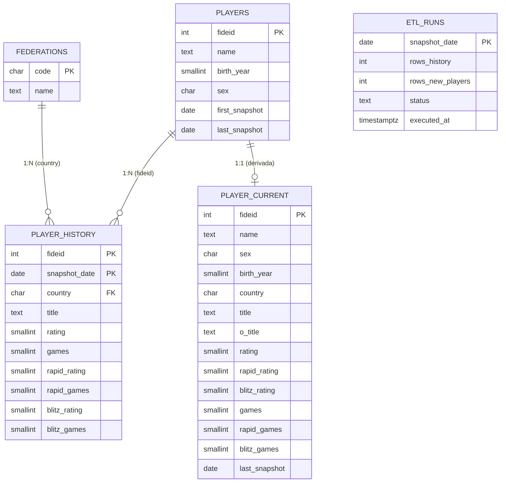

# Rediseño Conceptual de Base de Datos: Kepler-ChessAnalytics (v2)

**Proyecto:** Kepler-ChessAnalytics  
**Motor:** PostgreSQL 15+ (Supabase)  
**Consumidores:** Frontend Vue.js 3 (`web/`) vía PostgREST y Motor ETL Python (`src/`)  
**Estado:** Diseño conceptual 
**Fecha:** Octubre 2026  

---

## 1. Principios de Diseño

1. **Cada dato vive en un solo lugar.**
   * Lo que no cambia va en `players`.
   * Lo que cambia mes a mes va en `player_history`.
   * Lo que se puede calcular a partir de otro dato **no se guarda**.

2. **El historial es la fuente de verdad.** Guarda cómo era cada jugador *en ese mes* (país, título y ratings), no solo los ratings.

3. **Historial disperso con regla explícita.**
   * **Mes 0:** una fila por cada jugador del padrón.
   * **Meses siguientes:** solo se inserta fila si el jugador jugó partidas en alguna modalidad, o si cambió su rating, título o país respecto a su último registro.
   * Un jugador que aparece por primera vez después del mes 0 recibe fila ese mes (su primera fila actúa como su propio mes 0).

4. **"Activo" lo define el proyecto, no FIDE.** Se calcula desde las partidas jugadas y nunca se almacena como columna, para que no pueda contradecir a las partidas.

5. **Una fila ausente no es un dato.** La tabla `etl_runs` registra qué meses se cargaron, para distinguir "mes sin actividad" de "mes que no se cargó".

6. **La tabla para la web es una copia derivada.** `player_current` se reconstruye desde el historial en cualquier momento. Si difiere del historial, manda el historial.

---

## 2. Diagrama Entidad-Relación (ERD)

---

## 3. Diccionario de Datos

### 3.1. Tabla: `players` (quién es el jugador, casi inmutable)

| Columna | Tipo | Nulable | Regla / Descripción |
| :--- | :--- | :---: | :--- |
| **`fideid`** | entero | **NO** | `PRIMARY KEY`. Identificador FIDE. |
| **`name`** | texto | **NO** | Nombre oficial registrado ante FIDE (`APELLIDO, Nombre`). |
| **`birth_year`** | `SMALLINT` | **NO** | Solo el año de nacimiento: es lo único que entrega FIDE. |
| **`sex`** | 1 carácter | **NO** | `M` o `F`. |
| **`first_snapshot`** | `DATE` | **NO** | Primer mes en que el jugador apareció en el padrón. |
| **`last_snapshot`** | `DATE` | **NO** | Último mes en que apareció. Sirve para detectar bajas: si es anterior al corte vigente, el jugador ya no está en el padrón. |

### 3.2. Tabla: `player_history` (cómo era el jugador ese mes, hechos dispersos)

| Columna | Tipo | Nulable | Regla / Descripción |
| :--- | :--- | :---: | :--- |
| **`fideid`** | entero | **NO** | PK compuesta y FK a `players`. Sin borrado en cascada. |
| **`snapshot_date`** | `DATE` | **NO** | PK compuesta. Siempre el día 1 del mes (`YYYY-MM-01`). |
| **`country`** | código de 3 letras | **NO** | FK a `federations`. País del jugador **en ese mes**. |
| **`title`** | texto / enum | **NO** | Título deportivo **en ese mes**. |
| **`rating`** | `SMALLINT` | SÍ | Elo Clásico. `NULL` si no tiene Elo en esa modalidad. |
| **`games`** | `SMALLINT` | **NO** | Partidas clásicas del mes. Por defecto `0`. |
| **`rapid_rating`** | `SMALLINT` | SÍ | Elo Rápido. `NULL` si no tiene. |
| **`rapid_games`** | `SMALLINT` | **NO** | Partidas rápidas del mes. Por defecto `0`. |
| **`blitz_rating`** | `SMALLINT` | SÍ | Elo Blitz. `NULL` si no tiene. |
| **`blitz_games`** | `SMALLINT` | **NO** | Partidas blitz del mes. Por defecto `0`. |

### 3.3. Tabla: `federations` (catálogo de países)

| Columna | Tipo | Nulable | Regla / Descripción |
| :--- | :--- | :---: | :--- |
| **`code`** | código de 3 letras | **NO** | `PRIMARY KEY`. Código de federación (ej. `VEN`, `COL`, `ESP`, `FID`). |
| **`name`** | texto | **NO** | Nombre del país o federación para el frontend. |

Evita códigos de país inválidos y entrega el nombre legible a la interfaz.

### 3.4. Tabla: `etl_runs` (bitácora de cargas)

| Columna | Tipo | Nulable | Regla / Descripción |
| :--- | :--- | :---: | :--- |
| **`snapshot_date`** | `DATE` | **NO** | `PRIMARY KEY`. Mes cargado. |
| **`rows_history`** | entero | **NO** | Filas insertadas en `player_history`. |
| **`rows_new_players`** | entero | **NO** | Jugadores nuevos incorporados a `players`. |
| **`status`** | texto | **NO** | Estado de la carga (ej. `ok`, `fallido`). |
| **`executed_at`** | `TIMESTAMPTZ` | **NO** | Fecha y hora de ejecución. |

Si falta un mes en esta tabla, es un **mes sin cargar**, no un mes sin actividad.

### 3.5. Tabla: `player_current` (copia derivada para la web)

Una fila por jugador con su último estado conocido: el último registro del historial más sus datos fijos de `players`.

| Columna | Origen |
| :--- | :--- |
| `fideid`, `name`, `sex`, `birth_year` | `players` |
| `country`, `title`, `rating`, `rapid_rating`, `blitz_rating`, `games`, `rapid_games`, `blitz_games` | Último registro de `player_history` |
| `o_title` | Dato vigente de títulos arbitrales (sin historial, salvo que se decida analizar su evolución) |
| `last_snapshot` | `players.last_snapshot` |

Existe únicamente para que los rankings por país o por rating respondan rápido. Se reconstruye cada mes y **nunca se edita a mano**.

---

## 4. Datos que ya no se Guardan (se calculan al consultar)

| Dato | Cómo se obtiene |
| :--- | :--- |
| `total_games` | `games + rapid_games + blitz_games` |
| `activo_mes` | `total_games > 0` |
| `activo_12m` | Existe una fila con `total_games > 0` en los últimos 12 meses |
| `edad` | Año del `snapshot_date` menos `birth_year` |
| `categoria` (Sub 8 … Absoluta) | Función de la edad |
| `player_profile` | Qué ratings no son `NULL` en ese mes |

**Beneficio adicional:** `player_profile` pasa a variar mes a mes. Si un jugador obtiene su primer Elo rápido en 2024, su perfil cambia, algo que el diseño anterior ocultaba.

---

## 5. Reglas de la Carga Mensual

1. **Mes 0:** insertar una fila por cada jugador del padrón.
2. **Mes N:** para cada jugador, comparar con su último registro e insertar fila si ocurre **cualquiera** de estas condiciones:
   * `games + rapid_games + blitz_games > 0`.
   * Cambió algún rating, el título o el país.
   * Es su primera aparición en el padrón.
3. Actualizar `last_snapshot` de los jugadores presentes en el archivo del mes.
4. Registrar la ejecución en `etl_runs`.
5. Reconstruir `player_current` (solo las filas que cambiaron).
6. Ejecutar todo dentro de **una transacción**: si algo falla, no queda un mes a medias.

---

## 6. Cómo se Consulta el Modelo

| Pregunta | Cómo se responde |
| :--- | :--- |
| ¿Quién jugó en el mes M? | Filas de `player_history` con `snapshot_date = M` y partidas > 0 |
| ¿Cuál era el rating de X en el mes M? | Su último registro con `snapshot_date <= M` (el último dato conocido) |
| ¿Quién estaba activo en los últimos 12 meses? | Jugadores con alguna fila con partidas > 0 en esa ventana |
| ¿Ranking actual por país? | `player_current`, nunca el historial |
| ¿Qué país tenía X en 2019? | Su último registro de `player_history` hasta ese mes |

---

## 7. Decisiones Pendientes

1. **¿"Activo" mensual, de 12 meses, o ambos?** El ajedrez se juega por ráfagas, así que la definición mensual subestima la actividad real. Define cuál usarán los gráficos.
2. **¿Qué hacer con los jugadores que salen del padrón?** Propuesta: conservarlos y detectarlos con `last_snapshot`. Falta decidir si aparecen o no en los rankings.
3. **¿Importa la evolución de `o_title`?** Si no, queda solo en `player_current`.
4. **¿Título unificado o separado?** Hoy se mezclan `title` y `w_title` en uno. Si se quiere responder "¿cuántas WGM hay entre las GM?", conviene guardar ambos por separado.

---

## 8. Cambios Respecto al Diseño v1

| Aspecto | v1 | v2 |
| :--- | :--- | :--- |
| Rol de `players` | Maestro + estado vigente (20 columnas) | Solo datos casi inmutables (6 columnas) |
| Fuente de verdad | `players` y `player_history` (duplicadas) | Solo `player_history` |
| País y título | Solo en `players`, sobrescritos | En el historial, por mes |
| Datos derivados | Guardados (`edad`, `categoria`, `activo_mes`, `total_games`, `player_profile`) | Calculados al consultar |
| Mes 0 del historial | Solo activos o con rating | Todos los jugadores |
| Meses siguientes | Activos o con rating variado | Activos o con cambio de rating, título o país |
| Detección de meses faltantes | No existía | Tabla `etl_runs` |
| Tabla para la web | `players` (maestro y copia a la vez) | `player_current` (copia derivada, reconstruible) |
| Borrado de jugadores | `ON DELETE CASCADE` | Sin cascada; bajas detectadas con `last_snapshot` |

---

## 9. Próximos Pasos

1. Resolver las cuatro decisiones pendientes de la sección 7.
2. Escribir el DDL (tipos, constraints, índices).
3. Diseñar la lógica de carga (staging, comparación contra el último registro, transacción única).
4. Medir el tamaño real tras la primera carga (`pg_total_relation_size`) antes de proyectar la capacidad.