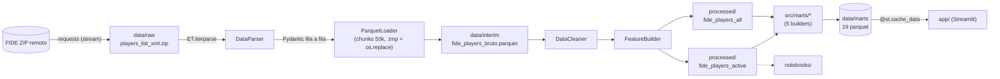

# Auditoría de Ingeniería de Datos — Kepler-ChessAnalitic

**Rol:** Ingeniero de Datos Senior (revisión independiente)
**Fecha:** 2026-10-13
**Insumos:** `repomix-output.xml` (todo `src/`), `tests/`, `pyproject.toml`, `requirements.txt`, `.gitignore`, `git ls-files`, listado de `data/`, `app/service/data_loader.py`.
**Verificación ejecutada:** `pytest` → 8 pruebas, todas en verde.

> [!NOTE]
> Este documento distingue entre **hallazgos verificados en el código** (con su evidencia) y **buenas prácticas ausentes** (brechas de madurez). Donde algo es una hipótesis y no un hecho comprobado, se indica explícitamente.

---

## 1. Resumen ejecutivo

El proyecto está **por encima de la media** para un repositorio de análisis de datos: tiene capas claras, ETL en streaming, escritura atómica en la ingesta, marts precalculados y una app que no recalcula nada. El riesgo no está en el diseño de alto nivel sino en **los bordes**: qué pasa cuando la descarga se corta, cuando la fuente cambia de forma, cuando alguien instala el proyecto en otra máquina, o cuando se regeneran los marts a medio camino.

Las tres prioridades con mejor relación esfuerzo/impacto:

1. **Fiabilidad de I/O** (descarga atómica, `--force-download` conectado, escritura atómica de marts).
2. **Compuerta de calidad** antes de publicar (volumen, nulos, rangos) y **cuarentena** de filas inválidas en lugar de abortar.
3. **Higiene de entorno y CI** (dependencias coherentes, lockfile, `ruff` + `pytest` en cada push).

> [!IMPORTANT]
> A esta escala (~776 mil filas, ~46 MB en Parquet bruto) **Pandas es suficiente**. DuckDB, Polars, Prefect o Dagster son valiosos como aprendizaje, pero **no son la causa de ningún problema actual**. Están priorizados al final a propósito.

---

## 2. Arquitectura actual

| Capa | Responsable | Escritura | Atómica |
| :--- | :--- | :--- | :---: |
| Raw | `FideDownloader` | `open(path, "wb")` directo | No |
| Interim | `ParquetLoader` | `.tmp` + `os.replace` | Sí |
| Processed | `ProcessingController` | `df.to_parquet(path)` | No |
| Marts | `src/marts/*` | `df.to_parquet(path)` ×19 | No |

Orquestación: `src/main.py` (CLI con `--stage all|ingest|process|marts`) → 3 controladores con `run_pipeline()`.

---

## 3. Fortalezas (conservar)

- **Separación por capas y por responsabilidad.** Controladores finos; builders de marts como funciones que reciben `df` y `output_dir` (fáciles de probar).
- **Streaming real** en la lectura del XML y escritura Parquet por lotes: memoria acotada.
- **Escritura atómica en `ParquetLoader`** con limpieza del `.tmp` ante error. Es el patrón correcto; solo falta replicarlo.
- **Marts precalculados**: la app no hace trabajo pesado, y se aplicó `random_state=42` al muestreo de KDE (determinismo).
- **Configuración centralizada** (`settings.py`, `constants.py`) y constantes de negocio fuera del código de cálculo.
- **Inyección de URL/rutas por constructor** en `FideDownloader` y controladores: facilita pruebas.
- **Tests de reglas de negocio reales** en `test_processing.py` (limpieza, categorías, split activo/total).

---

## 4. Hallazgos verificados

Severidad: 🔴 Alta · 🟠 Media · 🟡 Baja.

### 4.1 Fiabilidad y corrección

| ID | Sev. | Hallazgo | Evidencia | Corrección sugerida |
| :--- | :---: | :--- | :--- | :--- |
| **H1** | 🔴 | **Descarga no atómica + "saltar si existe" = archivo corrupto persistente.** Si la descarga se interrumpe, queda un ZIP truncado en `data/raw/`; la siguiente ejecución ve que el archivo existe, lo devuelve sin validar, y falla después en el parser (`BadZipFile`) o, peor, procesa datos parciales. | `fideDownloader.py`: `open(self.output_path, "wb")` directo y `if self.output_path.exists() and not force: return`. | Descargar a `.part`, validar (`zipfile.is_zipfile`, tamaño vs `content-length`, opcionalmente checksum) y `os.replace`. |
| **H2** | 🔴 | **`--force-download` no hace nada.** `main.run_pipeline(force_download=...)` nunca lo propaga; `IngestionController` fija `download_data(force=False)`. Además, sin `force` el pipeline **nunca refresca** la fuente. | `main.py` (comentario "podemos parametrizarlo si es necesario"), `ingestion_controller.py`. | Propagar el parámetro; idealmente decidir por `ETag`/`Last-Modified` o por `snapshot` mensual. |
| **H3** | 🔴 | **Sin compuerta de calidad antes de publicar.** Un XML con pocas filas o columnas vacías pasa limpieza, regenera todos los marts y los marts están versionados en git: el daño llega a producción. | Ningún chequeo de volumen/nulos/rangos en `processing_controller.py` ni `marts_controller.py`. | Validar antes de escribir `processed/` y antes de publicar `marts/` (ver Módulo 3). |
| **H4** | 🔴 | **Una fila inválida aborta toda la ingesta** (sin cuarentena) y la validación Pydantic es costosa por fila. | `IngestionController.validate_stream`: `FidePlayer(**record)` sin `try/except`; `fideid: int` y `name: str` son obligatorios. *Riesgo, no reproducido con datos reales.* | Capturar `ValidationError`, enviar a un archivo de rechazados con contador y umbral de aborto (p. ej. >0,1 %). Evaluar validación por lote. |
| **H5** | 🟠 | **Escritura no atómica de `processed/` y `marts/`.** Una falla a mitad deja un conjunto de marts mezcla de dos ejecuciones. | `processing_controller.py` y los 5 builders usan `to_parquet(path)` directo. | Escribir a un directorio temporal y hacer *swap* al final, o helper `atomic_to_parquet`. |
| **H6** | 🟠 | **Reproducibilidad temporal.** `reference_year = datetime.now().year`: reprocesar el mismo snapshot en otro año cambia `edad`, `categoria` y todos los marts juveniles. | `feature_builder.py` (`__init__`). | Derivar el año de referencia del `snapshot_date` del archivo fuente. |
| **H7** | 🟠 | **Rangos fijos que truncan en silencio.** KDE en `linspace(1380, 2860)`, histograma en `1400–2880`, fallbacks `1707/1635/1688`, `top 50`, `>= 500`. Si el rating máximo o mínimo se sale del rango, se pierde sin aviso. | `elo_marts.py`, `venezuela_marts.py`, `demographic_marts.py`. | Derivar límites de los datos (o validarlos con una aserción) y mover umbrales a `constants.py`. |
| **H8** | 🟡 | `np.select(..., default="Sin Categoría")` seguido de `pd.Categorical(categories=ORDERED_CATEGORIES)` convierte "Sin Categoría" en `NaN` (casos `edad <= 0`). Los `groupby(observed=True)` los descartan en silencio. | `feature_builder.py`. | Decidir explícitamente: filtrar en el cleaner o incluir la categoría. |
| **H9** | 🟡 | **Posible acumulación de memoria en `iterparse`.** Se hace `elem.clear()` del `player`, pero el `root` conserva referencias a ~776 mil nodos vacíos. *Hipótesis: medir con `tracemalloc` antes de actuar.* | `dataParser.py`. | Capturar el `root` del primer evento `start` y limpiarlo periódicamente. |

### 4.2 Dependencias, pruebas y entorno

| ID | Sev. | Hallazgo | Evidencia | Corrección sugerida |
| :--- | :---: | :--- | :--- | :--- |
| **D1** | 🔴 | **`pyarrow` no está en las dependencias base** del paquete, pero lo importa `ParquetLoader` y es necesario para `to_parquet`/`read_parquet`. Solo aparece en el extra `[app]`. Una instalación limpia del ETL falla. | `pyproject.toml` (`dependencies` vs `[app]`). | Moverlo a `dependencies`. |
| **D2** | 🟠 | **Dos fuentes de verdad** (`pyproject.toml` y `requirements.txt`) con contenidos distintos (el segundo omite `seaborn`/`matplotlib`) y **sin lockfile**. | Ambos archivos. | Una fuente (`pyproject.toml`) + lockfile (`uv.lock`); exportar `requirements.txt` solo para Streamlit Cloud. |
| **D3** | 🔴 | **Cobertura de pruebas parcial.** Hay 8 pruebas: procesamiento y servicios de la app. **Sin pruebas** para `DataParser`, `FideDownloader`, `ParquetLoader`, controladores ni los 5 builders de marts. La documentación (`research/EXPLICACION_ESTRUCTURA_DIRECTORIOS.md`) menciona `test_models.py`, `test_ingestion.py`, `test_marts.py`, que **no existen**. | `tests/` (solo `test_processing.py`, `test_services.py`). | Ver Módulo 2. |
| **D4** | 🟠 | **`test_services.py` no es hermética**: depende de los `.parquet` reales versionados en `data/marts/`. Es una prueba de contrato útil, pero no sustituye a pruebas unitarias con datos sintéticos. | `tests/test_services.py` (llama a `get_global_kpis()` etc. contra datos reales). | Separar con marcadores: `unit` (sintéticos) vs `integration` (marts reales). |
| **D5** | 🟠 | **Sin CI, linter, formateador, tipado estático, pre-commit ni contenedor.** | No existen `.github/`, `Dockerfile`, `Makefile`, `.pre-commit-config.yaml`. | Ver Módulo 5. |
| **D6** | 🟡 | Los notebooks se versionan **con salidas** y con rutas relativas (`../../data/...`): diffs ruidosos y fragilidad al mover archivos. | `Colombia.ipynb`, `01-eda_general.ipynb`. | `nbstripout` en pre-commit; rutas desde `src.config.settings`. |

### 4.3 Configuración, gobernanza y mantenibilidad

| ID | Sev. | Hallazgo | Evidencia | Corrección sugerida |
| :--- | :---: | :--- | :--- | :--- |
| **G1** | 🟠 | **`mart_venezuela.parquet` contiene registros a nivel jugador** (`fideid`, `name`, `birthday`, `edad`…), incluidos menores, y está **versionado en git**. Contradice la idea de "marts agregados" y abre una cuestión de privacidad/licencia. | `venezuela_marts.py` guarda `df_ven` con todas las columnas; `git ls-files` lo lista. | Decidir y documentar: minimizar columnas, o tratarlo como dato derivado con política explícita. Revisar términos de uso de los datos FIDE. |
| **G2** | 🟠 | **Marts versionados en git como mecanismo de despliegue.** Cada regeneración mensual añade binarios al historial. Además, `mart_ratings_clasico.parquet` pesa ~759 KB, frente al "< 200 KB" que declara la documentación. | `.gitignore` (`!data/marts/*.parquet`), `ls -lh data/marts`. | Aceptable para un MVP; planificar publicación como artefacto (release, bucket) cuando crezca. Corregir la documentación. |
| **G3** | 🟠 | **Efectos secundarios al importar `settings.py`** (`load_dotenv()` y `logger.warning` a nivel de módulo). Si falta `URL_DESCARGA` solo se advierte; el error aparece más tarde. El valor por defecto `url=FIDE_DOWNLOAD_URL` se fija en tiempo de importación. | `settings.py`, `fideDownloader.py`. | Validar al *iniciar el pipeline*, no al importar; fallar rápido con mensaje claro. |
| **G4** | 🟡 | **Rutas duplicadas**: `app/service/data_loader.py` calcula su propio `_ROOT`/`_MARTS` en vez de reutilizar `settings.py`. | `data_loader.py` líneas 12-14. | Fuente única de rutas (con cuidado de no acoplar la app a `loguru`/`dotenv`). |
| **G5** | 🟡 | **Repetición (DRY)**: el bloque "unstack M/F → asegurar columnas → total → pct" se copia ~5 veces. | `demographic_marts.py`, `youth_marts.py`. | Helper `gender_breakdown(df, by)`. |
| **G6** | 🟡 | **Higiene del repo**: `.gitignore` contiene `doc/auditorias/` (la carpeta real es `docs/auditorias/`, por lo que **no** se ignora); `repomix-output.xml` no está ignorado; `research/` se ignora pero la documentación versionada lo referencia. | `.gitignore`. | Corregir las rutas y decidir qué es versionable. |
| **G7** | 🟡 | **Observabilidad mínima**: `loguru` a `stderr`, sin archivo ni manifiesto de ejecución (filas leídas/descartadas, duración por fase, versión del código). | `settings.setup_environment`. | Ver Módulo 7. |

---

## 5. Mapa de brechas conceptuales

| Concepto | Estado actual | Observación |
| :--- | :--- | :--- |
| Idempotencia | **Parcial** | Reejecutar sobre el mismo ZIP produce el mismo resultado porque todo se sobrescribe. Pero depende del año actual (H6), del orden del dedupe y de que la descarga sea íntegra (H1). Es idempotencia *por reemplazo*, no *por diseño*. |
| Atomicidad | **Solo en Interim** | Replicar el patrón de `ParquetLoader` (H1, H5). |
| Calidad de datos | **Reglas de limpieza sí; contratos no** | `DataCleaner` filtra, pero nada verifica el conjunto resultante (H3). |
| Pruebas | **Núcleo cubierto, bordes no** | D3, D4. |
| Gestión de dependencias | **Inconsistente** | D1, D2. |
| CI/CD | **Ausente** | D5. |
| Linaje y observabilidad | **Ausente** | G7. |
| Datos históricos | **No soportado** | Cada corrida pisa la anterior; sin *snapshots*. |
| Orquestación | **Script secuencial suficiente hoy** | Reintentos y reanudación son la carencia real; un DAG es opcional. |
| Gobernanza / privacidad | **No tratada** | G1. |

---

## 6. Esquema de estudio

Los módulos están **ordenados por retorno sobre el esfuerzo**, no por glamour tecnológico. Cada uno incluye: teoría, por qué importa *en este proyecto*, un ejercicio concreto y un criterio de "terminado".

### Módulo 1 — Fiabilidad de I/O: atomicidad, idempotencia y determinismo
**Cierra:** H1, H2, H5, H6, H9.

- **Teoría:**
  - Idempotencia: $f(f(x)) = f(x)$ y la diferencia entre *idempotente por reemplazo* y *determinista* (misma entrada ⇒ misma salida, sin depender del reloj).
  - Escritura atómica: *write-to-temp + rename*; por qué `rename` es atómico en el mismo sistema de archivos.
  - Reintentos: errores transitorios vs permanentes, *exponential backoff* con *jitter*.
  - Descargas reanudables y condicionales: `Range`, `ETag`, `If-Modified-Since`.
  - Verificación de integridad: tamaño, checksum, `zipfile.is_zipfile`.
- **Recursos:** *Designing Data-Intensive Applications* (Kleppmann), cap. 1 y 11; artículo *Functional Data Engineering* (Maxime Beauchemin); *The Twelve-Factor App* (config y procesos).
- **Ejercicio:** reescribir `FideDownloader.download_data` con `.part` + validación + reintentos; propagar `--force-download`; crear `atomic_to_parquet()` y usarlo en procesamiento y marts.
- **Terminado cuando:** matar el proceso a mitad de descarga y volver a ejecutar produce un resultado correcto, y reprocesar el mismo ZIP en otro año da marts idénticos.

### Módulo 2 — Pruebas para pipelines de datos
**Cierra:** D3, D4.

- **Teoría:**
  - Pirámide de pruebas aplicada a datos: unitarias (funciones puras), de integración (capa a capa), de contrato (esquema de salida), *smoke tests* de extremo a extremo.
  - Datos sintéticos y *fixtures* de `pytest`; `tmp_path`; `monkeypatch`.
  - *Golden files* / pruebas de regresión sobre marts pequeños.
  - Pruebas basadas en propiedades con `Hypothesis` (p. ej. "para cualquier edad > 0, la categoría es una de las 8 válidas").
  - Cobertura (`pytest-cov`) y su uso correcto: indicador, no objetivo.
  - Marcadores `@pytest.mark.unit` / `integration`.
- **Recursos:** *Python Testing with pytest* (Brian Okken); documentación de `Hypothesis`; *Architecture Patterns with Python* (Percival & Gregory) para separar lógica de I/O.
- **Ejercicio:** un ZIP/XML sintético de 20 jugadores (con casos sucios) y pruebas para `DataParser`, `ParquetLoader` (incluida la limpieza del `.tmp` ante error) y cada builder de marts con un `df` mínimo.
- **Terminado cuando:** `pytest -m unit` corre en segundos sin tocar `data/`, y cada módulo de `src/` tiene al menos una prueba.

### Módulo 3 — Calidad de datos y contratos
**Cierra:** H3, H4, H7, H8.

- **Teoría:**
  - *Shift-left*: validar donde nace el dato.
  - Contrato de datos: esquema + restricciones semánticas + expectativas de volumen y frescura.
  - Validación **por fila** (Pydantic) vs **tabular** (Pandera / Great Expectations): cuándo usar cada una.
  - **Cuarentena / dead-letter**: no abortar por una fila mala; medir la tasa de rechazo y abortar solo sobre un umbral.
  - Detección de *schema drift*; pruebas de distribución básicas (rangos, nulos, cardinalidad, unicidad).
  - Compuertas de calidad (*quality gates*) entre capas.
- **Recursos:** documentación de `Pandera` y `Great Expectations`; *Fundamentals of Data Engineering* (Reis & Housley), capítulos de calidad y *undercurrents*.
- **Ejercicio:** un `DataFrameSchema` para `processed/` (p. ej. `rating` entre 1000 y 3200 o nulo, `fideid` único, `country` de 3 letras) y una compuerta que aborte si `n < 0,9 × n_mes_anterior`.
- **Terminado cuando:** un ZIP deliberadamente corrupto detiene el pipeline **antes** de tocar `data/marts/`, y las filas rechazadas quedan en un archivo con su motivo.

### Módulo 4 — Dependencias, entornos y empaquetado
**Cierra:** D1, D2.

- **Teoría:**
  - `pyproject.toml` (PEP 621) como fuente única; dependencias base vs *extras* vs *grupos de desarrollo*.
  - Rangos de versión (`>=`, `~=`) vs *pinning* y por qué un **lockfile** es lo que da reproducibilidad.
  - Paquete editable (`pip install -e .`) y por qué `sys.path.insert` en `conftest.py` es un parche.
  - Resolución de dependencias y entornos virtuales.
- **Recursos:** documentación de `uv`; Python Packaging User Guide.
- **Ejercicio:** mover `pyarrow` a `dependencies`, generar `uv.lock`, derivar `requirements.txt` para Streamlit Cloud con `uv export`, y probar una instalación limpia en un entorno vacío.
- **Terminado cuando:** `uv sync && pytest` funciona en una máquina limpia.

### Módulo 5 — DataOps: CI/CD, calidad de código y contenedores
**Cierra:** D5, D6, G6.

- **Teoría:**
  - Integración continua: qué debe fallar y en qué orden (lint → tipos → pruebas → *build*).
  - `ruff` (lint/format), `mypy`/`pyright` (tipado gradual), *hooks* de `pre-commit`.
  - GitHub Actions: *workflows*, *jobs*, caché de dependencias, matriz de versiones de Python.
  - Docker: imagen mínima, *multi-stage*, `.dockerignore`, usuario no root.
  - Higiene de notebooks: `nbstripout`.
- **Recursos:** documentación de GitHub Actions, `pre-commit`, `ruff`, `mypy`; *Docker Docs — best practices*.
- **Ejercicio:** `.github/workflows/ci.yml` (ruff + pytest + cobertura), `.pre-commit-config.yaml` (ruff, nbstripout, *check-added-large-files*), y un `Dockerfile` que ejecute `python -m src.main --stage all`.
- **Terminado cuando:** un push con una prueba rota o un error de lint queda bloqueado automáticamente.

### Módulo 6 — Modelado temporal y almacenamiento
**Cierra:** la ausencia de histórico (§5) y G2.

- **Teoría:**
  - *Snapshots* mensuales vs ingesta incremental / CDC.
  - Particionado estilo Hive (`snapshot=YYYY-MM/`) y poda de particiones.
  - Dimensiones de cambio lento (SCD tipo 2) para "jugador cambia de federación o título".
  - Parquet por dentro: *row groups*, estadísticas, codificación por diccionario, compresión; evolución de esquema.
  - Versionado de datos (DVC, lakeFS, Iceberg/Delta como contexto) y por qué no versionar binarios grandes en git.
- **Recursos:** *Designing Data-Intensive Applications*, cap. 3 y 10; especificación de Apache Parquet; documentación de DVC.
- **Ejercicio:** guardar `raw`/`interim` bajo `snapshot=YYYY-MM/`, derivar `reference_year` del snapshot, y calcular una métrica de evolución (cambio de Elo medio por federación entre dos meses).
- **Terminado cuando:** dos snapshots conviven y se puede consultar la diferencia entre ellos sin reejecutar nada.

### Módulo 7 — Observabilidad y linaje
**Cierra:** G7.

- **Teoría:**
  - Los cinco pilares: frescura, volumen, esquema, distribución, linaje.
  - *Logging* estructurado (JSON) y correlación por `run_id`.
  - **Manifiesto de ejecución**: qué entró, qué se descartó, qué salió, cuánto tardó, con qué versión de código (hash de git).
  - SLAs/SLOs de datos (p. ej. "los marts nunca tienen más de 40 días").
  - OpenLineage como estándar de linaje (a nivel conceptual).
- **Recursos:** documentación de `OpenLineage`; *Data Pipelines Pocket Reference* (James Densmore).
- **Ejercicio:** al final de cada fase, escribir `runs/<run_id>.json` con conteos, duración y `git rev-parse HEAD`; mostrar en la app la fecha del snapshot y la última ejecución.
- **Terminado cuando:** ante un resultado extraño se puede responder "¿qué archivo y qué código lo generaron?" sin adivinar.

### Módulo 8 — Motores analíticos y orquestación *(opcional, por aprendizaje)*
**No cierra ningún hallazgo actual.**

- **Teoría:**
  - Ejecución columnar y vectorizada; *predicate/projection pushdown*; evaluación perezosa (*lazy*) vs ansiosa (*eager*).
  - Cuándo Pandas deja de ser suficiente (señales: memoria, tiempo, copias) y cuándo es una optimización prematura.
  - Orquestación: DAGs, dependencias, reintentos, *backfills*, estado; Prefect/Dagster vs un script bien hecho.
  - Interoperabilidad con Arrow (compartir memoria sin copias).
- **Recursos:** documentación de `DuckDB` y `Polars`; *DuckDB in Action* (Needham & Hunger); documentación de Prefect/Dagster.
- **Ejercicio:** reimplementar **un** mart (p. ej. demografía) en DuckDB sobre el Parquet y comparar tiempo, memoria y legibilidad contra la versión Pandas, **con una prueba que verifique resultados idénticos**.
- **Terminado cuando:** tienes una comparación medida (no una opinión) que justifique migrar o no.

### Módulo 9 — Gobernanza y privacidad de datos *(transversal, corto)*
**Cierra:** G1.

- **Teoría:** datos personales vs datos públicos, minimización, datos de menores, licencias y términos de uso de la fuente, *data classification*, retención.
- **Ejercicio:** un `docs/GOBERNANZA.md` con columnas que contienen datos personales, qué capa las expone, y la política para `mart_venezuela`.
- **Terminado cuando:** puedes justificar por escrito qué datos personales hay en el repo público y por qué.

---

## 7. Hoja de ruta sugerida

| Etapa | Contenido | Esfuerzo | Hallazgos que cierra |
| :--- | :--- | :---: | :--- |
| **1. Quick wins** | `pyarrow` a dependencias; propagar `--force-download`; corregir `.gitignore`; descarga con `.part` + validación | S | D1, H1, H2, G6 |
| **2. Red de seguridad** | Pruebas unitarias de parser/loader/marts con datos sintéticos; marcadores `unit`/`integration` | M | D3, D4 |
| **3. CI** | `uv.lock`, `ruff`, `pre-commit`, GitHub Actions | M | D2, D5, D6 |
| **4. Calidad** | Esquema Pandera, cuarentena de filas, compuerta antes de publicar marts, escritura atómica | M | H3, H4, H5, H7, H8 |
| **5. Tiempo y trazabilidad** | `snapshot_date`, `reference_year` derivado, manifiesto de ejecución | M | H6, G7 |
| **6. Gobernanza** | Política de datos personales y de publicación de marts | S | G1, G2 |
| **7. Exploración** | DuckDB/Polars en un mart; orquestador si hay motivo | L | — |

*S = horas · M = días · L = semanas.*

---

## 8. Relación con la auditoría previa (`auditoria.md`)

Coincido con su estructura general. Diferencias de criterio y aportes de esta revisión:

- **Idempotencia:** el pipeline **sí** es idempotente por reemplazo; el problema real es la **no determinación temporal** (H6) y la **descarga no atómica** (H1), que la auditoría previa no identifica.
- **Escala:** no recomiendo migrar a DuckDB/Polars ni adoptar un orquestador como *corrección*; a 776 mil filas es una decisión de aprendizaje, no de necesidad.
- **Hallazgos nuevos verificados:** H1, H2 (flag muerto), D1 (`pyarrow` ausente), D3 (documentación que cita pruebas inexistentes), G1 (datos a nivel jugador versionados), G2 (tamaño real de marts vs documentación), G6 (`.gitignore` con ruta errónea).
- **Pandera:** se mantiene como recomendación, pero se enfatiza más la **cuarentena y la compuerta de volumen** que el cambio de librería de validación.

